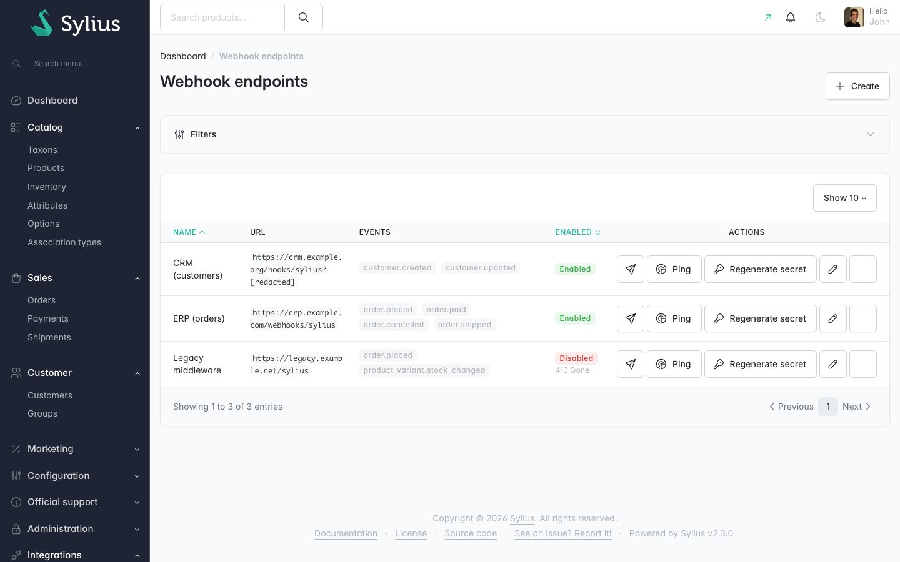
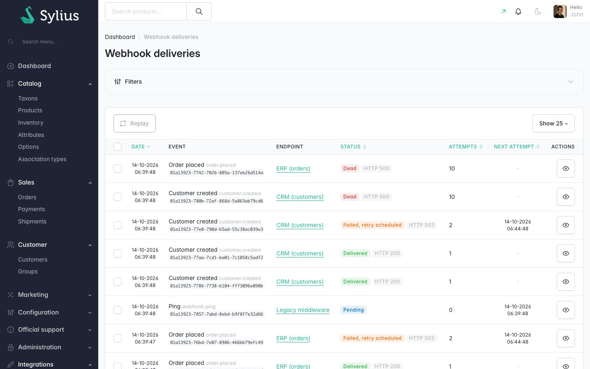
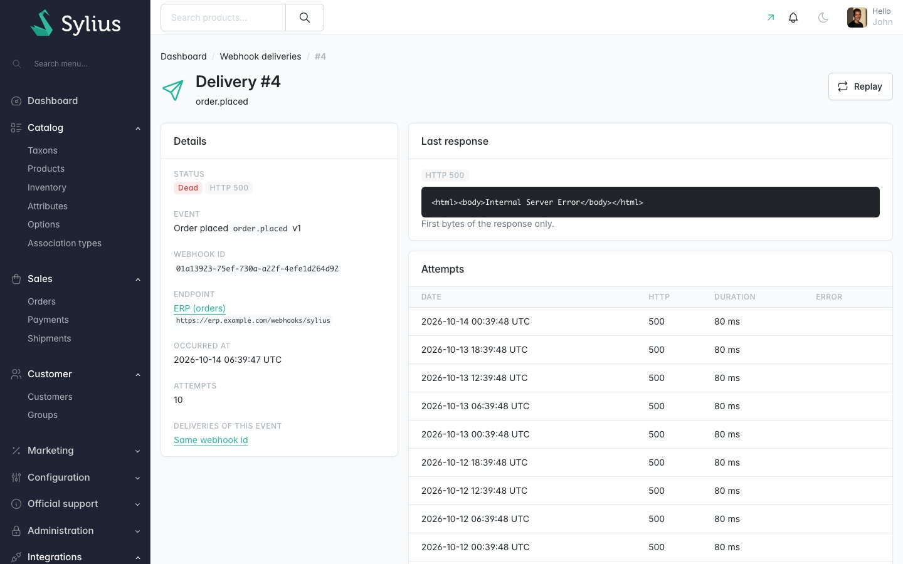
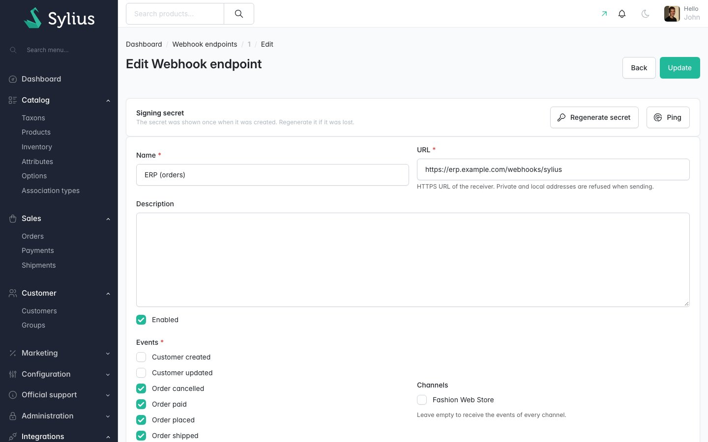

# Sylius Webhook Outbox Plugin

> English: [README.md](README.md) <!-- vitrine:lang -->

[](https://github.com/thibmonier/sylius-webhook-outbox-plugin/actions/workflows/build.yaml)
[](LICENSE)

**Des webhooks sortants pour Sylius 2 qui ne se perdent jamais : une outbox transactionnelle, des
signatures Standard Webhooks, des nouvelles tentatives, des dead letters et un rejeu depuis le
back-office.**

Votre ERP, votre CRM ou votre iPaaS veut savoir quand une commande est passée, payée, expédiée ou
annulée, quand un client s'inscrit, quand le stock bouge. Sylius 2 n'a pas de webhooks sortants, et
l'approche habituelle (« envoyer un appel HTTP dans un listener ») perd des événements quand l'appel
échoue, envoie des événements pour des changements annulés par un rollback, et ne laisse aucune trace.

Ce plugin écrit chaque événement **dans la même transaction de base de données** que le changement
qui l'a provoqué (l'outbox), puis un worker le livre par une requête HTTP signée, réessaie pendant
environ trois jours, place ce qui échoue encore dans une liste de dead letters et permet à un
administrateur de le rejouer. Il est gratuit et open source.

## Fonctionnalités

| Besoin | Ce que fait le plugin |
|---|---|
| Ne jamais perdre un événement, ne jamais en envoyer un fantôme | Les événements sont capturés depuis l'unit of work de Doctrine et insérés **dans la transaction du changement métier** : validés si et seulement si la commande, le paiement ou le client le sont. Fonctionne quel que soit le point d'entrée (boutique, API, administration, CLI). |
| Savoir ce qui s'est passé dans la boutique | `order.placed`, `order.paid`, `order.cancelled`, `order.shipped`, `customer.created`, `customer.updated` (champs autorisés uniquement), `product_variant.stock_changed` (**un événement par flush**, pas par ligne de commande), `webhook.ping`. |
| Des payloads stables et documentés | Une enveloppe versionnée `{id, type, version, timestamp, channel, data}` ; `data` provient des normalizers propres au plugin (pas de dump API Platform) et ne contient jamais de mots de passe, de jetons ni le jeton de la commande. [JSON Schemas](docs/schemas) fournis. |
| Faire confiance à l'émetteur | Signatures [Standard Webhooks](https://github.com/standard-webhooks/standard-webhooks/blob/main/spec/standard-webhooks.md) v1 (`webhook-id`, `webhook-timestamp`, `webhook-signature: v1,<base64>`, secrets `whsec_`), testées avec les vecteurs de la spécification. Extraits de code pour les récepteurs PHP et Node ci-dessous. |
| Survivre aux pannes du récepteur | Nouvelles tentatives pilotées par la base de données : immédiatement, 5 s, 5 min, 30 min, 2 h, 5 h, 10 h, 14 h, 20 h, 24 h (+ jitter). `Retry-After` respecté sur 429/502/503/504 (tous les formats de date HTTP). `410 Gone` désactive l'endpoint et suspend ses autres envois. Après la dernière tentative (environ 3 jours et 4 heures après l'événement), l'envoi est **dead** (liste des dead letters). |
| L'exploiter | **Intégrations › Endpoints webhook / Envois de webhooks / Échecs définitifs** dans l'administration : CRUD des endpoints (secret affiché **une seule fois**, régénération, ping), grille des envois avec filtres, page d'un envoi (corps de la requête, réponse tronquée, 10 dernières tentatives), **Réessayer maintenant**, **Rejouer** (unitaire et groupé, même `webhook-id`). |
| Rester sûr | Client HTTP dédié : réseaux privés et link-local bloqués après résolution DNS (`NoPrivateNetworkHttpClient`), pas de redirections, https uniquement, délai d'inactivité de 15 s, durée maximale de 30 s. Les secrets ne sont jamais journalisés ni réaffichés. |
| Fonctionner partout | `tmonier:webhook:dispatch` fonctionne depuis cron (`--time-limit`) ou comme worker persistant (`--loop`) ; les réservations utilisent `SELECT … FOR UPDATE SKIP LOCKED` et un bail (lease), de sorte que l'envoi d'un worker planté est repris. |
| Respecter le RGPD | `tmonier:webhook:purge` (rétention), `tmonier:webhook:anonymize-customer` (effacement des payloads **et** des extraits de réponse). |
| Ajouter vos propres événements | Registre de types d'événements par tag et API publique de recorder : un plugin de devis peut publier `quote.accepted`, un plugin de facturation électronique `invoice.issued`. |

Également inclus : traductions en anglais, français, allemand, espagnol, italien, néerlandais et
polonais ; Twig Hooks ; prise en charge de MySQL 8, MariaDB 10.6+ et PostgreSQL.

## Captures d'écran









## Prérequis

| | Version |
|---|---|
| PHP | 8.2+ |
| Sylius | 2.2, 2.3 |
| Symfony | 6.4, 7.4, 8.0 |
| Base de données | MySQL 8+, MariaDB 10.6+, PostgreSQL 10+ (voir [Workers](#workers) pour les serveurs plus anciens) |

## Installation

1. Installez le paquet :

    ```bash
    composer require tmonier/sylius-webhook-outbox-plugin
    ```

2. Enregistrez le bundle dans `config/bundles.php` (Symfony Flex le fait automatiquement dès qu'une recipe existe) :

    ```php
    Tmonier\SyliusWebhookOutboxPlugin\TmonierSyliusWebhookOutboxPlugin::class => ['all' => true],
    ```

3. Importez la configuration dans `config/packages/tmonier_sylius_webhook_outbox.yaml` :

    ```yaml
    imports:
        - { resource: "@TmonierSyliusWebhookOutboxPlugin/config/config.yaml" }
    ```

4. Importez les routes d'administration dans `config/routes/tmonier_sylius_webhook_outbox.yaml` :

    ```yaml
    tmonier_sylius_webhook_outbox:
        resource: "@TmonierSyliusWebhookOutboxPlugin/config/routes.yaml"
    ```

5. Exécutez les migrations :

    ```bash
    bin/console doctrine:migrations:migrate
    ```

6. Lancez le worker (voir [Workers](#workers)) et planifiez la purge, par exemple chaque jour :

    ```bash
    bin/console tmonier:webhook:purge
    ```

7. Définissez `framework.router.default_uri` (par exemple `https://shop.example.com`) afin que
   l'`admin_url` des payloads enregistrés depuis des commandes console pointe vers votre boutique.

## Configuration

Toutes les clés sont facultatives ; voici les valeurs par défaut.

```yaml
tmonier_sylius_webhook_outbox:
    enabled: true                    # capture events (the worker keeps delivering what is queued)
    events:                          # per type switch, e.g.
        product_variant.stock_changed: { enabled: true }
    retry_schedule: [0, 5, 300, 1800, 7200, 18000, 36000, 50400, 72000, 86400]
                                     # seconds before attempt 1, 2, 3...; its length = attempts
    retry_jitter: 0.1                # up to +10% on each delay
    timeout: 15                      # idle timeout of a request, seconds
    max_duration: 30                 # total duration of a request, seconds
    response_body_max_bytes: 2048    # response excerpt kept for the admin panel
    retention_days: 30               # default of tmonier:webhook:purge (null: keep forever)
    allow_http_endpoints: false      # accept http:// URLs: development only
    allowed_private_networks: []     # e.g. ['10.0.12.0/24'] for an ERP on your LAN
    url_redaction_pattern: '…'       # path segments hidden in logs / errors / admin (null: none)
```

Un événement n'est stocké que si au moins un endpoint activé le souscrit (et accepte son canal) :
sans endpoint, le plugin n'écrit rien.

`allowed_private_networks` perce des trous dans les plages bloquées, tout le reste demeure
bloqué, y compris après la résolution DNS. Utilisez des plages exactes.

## Événements

| Type | Quand | `data` | Canal |
|---|---|---|---|
| `order.placed` | `checkoutState` passe à `completed` (ou une commande est créée déjà terminée) | [commande](docs/schemas/order.v1.json) | canal de la commande |
| `order.paid` | `paymentState` passe à `paid` | commande | canal de la commande |
| `order.shipped` | `shippingState` passe à `shipped` | commande | canal de la commande |
| `order.cancelled` | `state` passe à `cancelled` | commande | canal de la commande |
| `customer.created` | un client est créé (invités compris : Sylius en crée un par e-mail de commande) | [client](docs/schemas/customer.v1.json) | null |
| `customer.updated` | l'e-mail, le prénom / nom, le téléphone, le genre, la date de naissance, le groupe ou la newsletter changent, ou un client existant (ancien invité) crée un compte (`has_account`) ; `changed_fields` les liste | client | null |
| `product_variant.stock_changed` | `onHand` ou `onHold` des variantes change, ou une variante suivie est créée (stock initial, `previous` null) ; **un événement par flush** listant toutes les variantes | [stock](docs/schemas/product_variant.stock_changed.v1.json) | null |
| `webhook.ping` | bouton **Ping** ; envoyé à cet endpoint uniquement | [ping](docs/schemas/webhook.ping.v1.json) | null |

Plusieurs événements d'un même flush sont indépendants : un récepteur peut recevoir `order.paid`
avant `order.placed` après une nouvelle tentative. `timestamp` a une précision d'une seconde et est
identique pour les événements d'un même flush : ordonnez les événements par `id` à la place (UUIDv7,
ordonné dans le temps ; le plugin rend les identifiants d'un même processus strictement croissants,
de sorte que `order.placed` se trie avant le `order.paid` du même flush), et appuyez-vous sur les
champs d'état de `data`.

### Enveloppe

Chaque corps de requête ([schéma](docs/schemas/envelope.json)) :

```json
{
    "id": "0199d3a8-5b1e-7c43-9a51-2f7f3c1d9e02",
    "type": "order.placed",
    "version": 1,
    "timestamp": "2026-10-11T08:14:03Z",
    "channel": "FASHION_WEB",
    "data": { "…": "…" }
}
```

- `id` est un UUIDv7, égal à l'en-tête `webhook-id`. Il est **identique pour chaque nouvelle
  tentative et chaque rejeu** de l'événement : utilisez-le pour dédupliquer.
- `version` est la version du DTO `data` de ce type. Les champs sont seulement ajoutés au sein
  d'une version ; un changement incompatible reçoit une nouvelle version.
- Les dates sont en ISO 8601 (RFC 3339). Les montants sont des entiers dans la plus petite unité
  de la devise (centimes). Les identifiants sont les identifiants de base de données de Sylius.
- Sous MySQL, les membres de `data` peuvent arriver dans un autre ordre que celui documenté (MySQL
  normalise les objets JSON) : analysez le JSON, ne comparez jamais des chaînes.

### Données `order.*` (version 1)

```json
{
    "id": 20,
    "number": "000000020",
    "admin_url": "https://shop.example.com/admin/orders/20",
    "channel": "FASHION_WEB",
    "currency_code": "USD",
    "locale_code": "en_US",
    "state": "new",
    "checkout_state": "completed",
    "payment_state": "awaiting_payment",
    "shipping_state": "ready",
    "checkout_completed_at": "2026-10-04T00:28:14+00:00",
    "totals": { "items": 39105, "shipping": 595, "tax": 0, "promotion": -1000, "total": 39700 },
    "promotion_coupon": null,
    "customer": { "id": 13, "email": "aniyah@example.com", "first_name": "Aniyah", "last_name": "Larson", "phone_number": "1-520-372-9575", "has_account": true },
    "billing_address": { "first_name": "Eva", "last_name": "Batz", "company": null, "street": "8867 Zulauf Estate", "city": "Port Margretshire", "postcode": "62021", "country_code": "PL", "province_code": null, "province_name": null, "phone_number": null },
    "shipping_address": { "…": "same members as billing_address" },
    "items": [
        { "id": 60, "variant_code": "Cool_Breeze_Jeans-variant-4", "product_code": "Cool_Breeze_Jeans", "product_name": "Cool Breeze Jeans", "variant_name": "XXL", "quantity": 5, "unit_price": 8021, "total": 39105 }
    ],
    "payments": [ { "id": 20, "method_code": "bank_transfer", "state": "new", "amount": 39700, "currency_code": "USD" } ],
    "shipments": [ { "id": 20, "method_code": "dhl_express", "state": "ready", "tracking": null, "shipped_at": null } ],
    "notes": null
}
```

Jamais inclus : le jeton de la commande (`tokenValue`), l'adresse IP du client, les détails de paiement.

### Données `customer.*` (version 1)

```json
{
    "id": 13,
    "admin_url": "https://shop.example.com/admin/customers/13",
    "email": "aniyah@example.com",
    "first_name": "Aniyah",
    "last_name": "Larson",
    "phone_number": "1-520-372-9575",
    "gender": "f",
    "birthday": "1990-04-02",
    "group": "retail",
    "subscribed_to_newsletter": false,
    "has_account": true,
    "created_at": "2026-10-01T09:12:44+00:00",
    "changed_fields": ["last_name"]
}
```

`changed_fields` n'est présent que dans `customer.updated`. L'utilisateur de la boutique (mot de
passe, salt, jetons, rôles) n'est jamais exposé : `has_account` indique s'il en existe un.

### Données `product_variant.stock_changed` (version 1)

```json
{
    "variants": [
        { "id": 412, "code": "Cool_Breeze_Jeans-variant-4", "product_code": "Cool_Breeze_Jeans", "admin_url": "https://shop.example.com/admin/products/87/variants/412/edit", "tracked": true, "on_hand": 20, "on_hold": 5, "available": 15, "previous": { "on_hand": 20, "on_hold": 0 } }
    ]
}
```

### Données `webhook.ping` (version 1)

```json
{ "endpoint_id": 3, "endpoint_name": "ERP", "message": "Ping from Sylius" }
```

## Recevoir les webhooks

Chaque requête est un `POST` avec `Content-Type: application/json` et trois en-têtes :
`webhook-id`, `webhook-timestamp` (secondes Unix) et `webhook-signature`
(`v1,<base64 HMAC-SHA256>`, éventuellement plusieurs séparées par des espaces). Le contenu signé est
`{webhook-id}.{webhook-timestamp}.{raw body}`, la clé est la partie décodée en base64 du secret
`whsec_…`. Répondez `2xx` rapidement (dans les 15 s) et traitez de façon asynchrone ; toute autre
réponse est réessayée, `410 Gone` désactive l'endpoint (ses envois en attente sont suspendus
jusqu'à ce qu'un administrateur le réactive).

N'importe quelle [bibliothèque Standard Webhooks](https://github.com/standard-webhooks/standard-webhooks/tree/main/libraries)
convient. Sans bibliothèque :

**PHP**

```php
function verifyWebhook(string $body, array $headers, string $secret, int $tolerance = 300): array
{
    $id = $headers['webhook-id'] ?? '';
    $timestamp = $headers['webhook-timestamp'] ?? '';
    if (!ctype_digit($timestamp) || abs(time() - (int) $timestamp) > $tolerance) {
        throw new RuntimeException('Invalid timestamp');
    }

    $key = base64_decode(substr($secret, strlen('whsec_')), true);
    $expected = 'v1,' . base64_encode(hash_hmac('sha256', "$id.$timestamp.$body", $key, true));
    foreach (explode(' ', $headers['webhook-signature'] ?? '') as $signature) {
        if (hash_equals($expected, $signature)) {
            return json_decode($body, true, flags: JSON_THROW_ON_ERROR);
        }
    }

    throw new RuntimeException('Invalid signature');
}

// $body must be the raw request body, before any JSON decoding.
$event = verifyWebhook(file_get_contents('php://input'), [
    'webhook-id' => $_SERVER['HTTP_WEBHOOK_ID'] ?? '',
    'webhook-timestamp' => $_SERVER['HTTP_WEBHOOK_TIMESTAMP'] ?? '',
    'webhook-signature' => $_SERVER['HTTP_WEBHOOK_SIGNATURE'] ?? '',
], getenv('SYLIUS_WEBHOOK_SECRET'));
```

**Node.js** (Express, corps brut)

```js
const crypto = require('node:crypto');
const express = require('express');

function verifyWebhook(rawBody, headers, secret, tolerance = 300) {
    const id = headers['webhook-id'];
    const timestamp = headers['webhook-timestamp'];
    if (!/^\d+$/.test(timestamp ?? '') || Math.abs(Date.now() / 1000 - Number(timestamp)) > tolerance) {
        throw new Error('Invalid timestamp');
    }

    const key = Buffer.from(secret.replace(/^whsec_/, ''), 'base64');
    const expected = Buffer.from('v1,' + crypto.createHmac('sha256', key).update(`${id}.${timestamp}.${rawBody}`).digest('base64'));
    const valid = (headers['webhook-signature'] ?? '').split(' ').some((signature) => {
        const given = Buffer.from(signature);
        return given.length === expected.length && crypto.timingSafeEqual(given, expected);
    });
    if (!valid) {
        throw new Error('Invalid signature');
    }

    return JSON.parse(rawBody);
}

const app = express();
app.post('/webhooks/sylius', express.raw({ type: 'application/json' }), (req, res) => {
    let event;
    try {
        event = verifyWebhook(req.body.toString('utf8'), req.headers, process.env.SYLIUS_WEBHOOK_SECRET);
    } catch (error) {
        return res.status(400).send(error.message);
    }
    queue.push(event); // process asynchronously
    res.sendStatus(204);
});
```

### Idempotence

La livraison est **au moins une fois** (at least once) : un timeout après que votre serveur a traité la
requête, un plantage de worker ou le rejeu d'un administrateur renvoie le même événement, toujours
avec le même `webhook-id`. Stockez les identifiants traités (un index unique suffit) et ignorez les
doublons :

```sql
CREATE TABLE sylius_webhooks_received (webhook_id CHAR(36) PRIMARY KEY, received_at TIMESTAMP NOT NULL);
-- INSERT ... ; on duplicate key: already processed, answer 200 and do nothing.
```

Conservez les identifiants au moins aussi longtemps que la fenêtre de nouvelles tentatives (la somme
de `retry_schedule` : environ 3 jours et 4 heures par défaut, jusqu'à 10 % de plus avec le jitter)
plus le temps pendant lequel un administrateur peut rejouer (la rétention, 30 jours par défaut).

## Workers

`tmonier:webhook:dispatch` réserve les envois échus un par un (`SELECT … FOR UPDATE SKIP
LOCKED`, puis un bail de `max_duration` + 60 s), les envoie et enregistre le résultat. Plusieurs
workers peuvent tourner ; un seul suffit pour la plupart des boutiques.

| Option | |
|---|---|
| (aucune) | envoie ce qui est échu, puis s'arrête |
| `--loop` | continue d'interroger (`--sleep` secondes quand il n'y a rien, 1 par défaut) |
| `--time-limit=N` | s'arrête après N secondes |
| `--limit=N` | s'arrête après N envois |

Il termine l'envoi en cours sur `SIGTERM` / `SIGINT`. Un worker tué au milieu d'une requête laisse
un bail qui expire ; l'envoi est alors renvoyé (les récepteurs dédupliquent avec `webhook-id`).

**Cron** (chaque minute). Une exécution ne démarre qu'une requête que `max_duration` laisse
se terminer avant `--time-limit` (qui doit donc être supérieur à `max_duration`) : avec `--time-limit=55`
et les 30 s par défaut, les requêtes démarrent pendant les 25 premières secondes de chaque minute.
La résolution DNS n'est pas bornée par `max_duration`, donc `flock -n` saute une exécution tant que
la précédente est encore occupée. Pour un flux régulier, préférez un worker persistant `--loop`
(systemd, Supervisor ci-dessous) :

```cron
* * * * * cd /var/www/shop && flock -n var/webhooks.lock php bin/console tmonier:webhook:dispatch --time-limit=55 >> var/log/webhooks.log 2>&1
```

**systemd** (`/etc/systemd/system/sylius-webhooks.service`) :

```ini
[Unit]
Description=Sylius webhook outbox worker
After=network-online.target mysql.service

[Service]
User=www-data
WorkingDirectory=/var/www/shop
ExecStart=/usr/bin/php bin/console tmonier:webhook:dispatch --loop --time-limit=3600 --env=prod
Restart=always
RestartSec=5

[Install]
WantedBy=multi-user.target
```

**Supervisor** :

```ini
[program:sylius-webhooks]
command=php /var/www/shop/bin/console tmonier:webhook:dispatch --loop --time-limit=3600 --env=prod
user=www-data
autorestart=true
stopsignal=TERM
stopwaitsecs=40
```

`SKIP LOCKED` exige que DBAL connaisse la vraie version du serveur : quand `doctrine.dbal.server_version`
est figé sur une ancienne version (par exemple `5.7`, comme dans l'application de test de Sylius), le worker
se rabat sur un simple `FOR UPDATE`. Les envois ne sont toujours réservés qu'une fois, mais les workers
concurrents s'attendent les uns les autres : lancez un seul worker, ou définissez `server_version` sur votre
vraie version (`8.4.0`, `mariadb-11.4.0`, `17`).

## Commandes

| Commande | |
|---|---|
| `tmonier:webhook:dispatch` | le worker, voir ci-dessus |
| `tmonier:webhook:purge [--days=N] [--dry-run]` | supprime les événements plus anciens que N jours (par défaut `retention_days`) avec leurs envois ; les événements dont un envoi est encore en attente ou en échec sont conservés |
| `tmonier:webhook:anonymize-customer <id or e-mail>` | masque les données personnelles des événements du client (payloads) et supprime les extraits de réponse de ses envois |

## Endpoints désactivés

Quand un endpoint est désactivé (par un administrateur ou après un `410 Gone`), ses envois en attente
et en échec passent à **suspendu** : non tentés, pas des dead letters, et purgeables après la
rétention. Réactiver l'endpoint les remet en file. Le ping, le rejeu et la nouvelle tentative sont
refusés tant que l'endpoint est désactivé.

## Données personnelles

Les payloads de webhooks contiennent des données personnelles (noms, e-mails, adresses). Avant d'ajouter
un endpoint, qualifiez le récepteur : votre propre ERP n'est pas un tiers ; un iPaaS ou un SaaS agissant
pour votre compte est un sous-traitant (RGPD art. 28, un accord de traitement des données est nécessaire) ;
un partenaire qui utilise les données pour ses propres finalités est un responsable de traitement
indépendant ; un récepteur hors de l'EEE constitue un transfert (chapitre V : décision d'adéquation
telle que le EU-US Data Privacy Framework, ou clauses contractuelles types). N'abonnez les endpoints
qu'aux événements dont ils ont besoin.

`tmonier:webhook:anonymize-customer` remplace les membres personnels (e-mail, noms, téléphone,
lignes d'adresse, notes, codes de suivi...) par `null` et marque les événements comme anonymisés.
**Les événements anonymisés ne peuvent pas être rejoués** : renvoyer un payload vidé sous le même
`webhook-id` serait soit ignoré par le récepteur, soit écraserait ses données avec des valeurs vides.
Les nouvelles tentatives encore en attente sont envoyées avec le payload masqué.

## Secrets

- Générés par le plugin (`whsec_` + 32 octets aléatoires), affichés **une seule fois**, dans la réponse
  à la requête de création ou de régénération (`Cache-Control: no-store`), jamais stockés dans la
  session, jamais réaffichés, jamais journalisés.
- Stockés en clair dans `tmonier_webhook_endpoint.secret` (ils sont nécessaires pour signer) :
  protégez les dumps de base de données en conséquence.
- La régénération remplace le secret immédiatement (pas de période de chevauchement dans cette version).
- Les URL d'endpoint sont souvent aussi des identifiants (jetons dans la query string, chemins de style
  Slack / Make / Zapier). Les journaux, les erreurs enregistrées ainsi que les grilles et pages
  d'administration les montrent reconstruites sans informations utilisateur, sans query string et sans les
  segments de chemin qui ressemblent à des jetons
  (`url_redaction_pattern` : 6+ caractères mêlant lettres et chiffres, 5+ chiffres, ou 20+
  caractères ; les secrets courts composés uniquement de lettres ne peuvent pas être détectés). Pour les URL
  de hooks Zapier, Slack, Discord et Make, tout le chemin après le préfixe du hook est masqué. `dump()`, le
  profiler et la barre de débogage montrent l'endpoint avec son secret et son URL masqués (caster VarDumper).
  Seul le formulaire d'édition de l'endpoint montre l'URL complète.

## Sécurité réseau

Les envois utilisent un client HTTP dédié : les adresses privées, de loopback et link-local sont
refusées après la résolution DNS (`NoPrivateNetworkHttpClient`, symfony/http-client 6.4.15+ pour
le correctif de la CVE-2024-50342), les redirections ne sont pas suivies, `http://` est refusé sauf si
`allow_http_endpoints`. **Les variables d'environnement de proxy (`HTTP_PROXY`, `HTTPS_PROXY`,
`ALL_PROXY`) sont ignorées par ce client** : un proxy résout lui-même l'hôte et contournerait
la vérification. Si vos serveurs ne peuvent joindre Internet qu'à travers un proxy, les webhooks ne
peuvent pas être envoyés depuis ceux-ci dans cette version.
- **Avec tmonier/sylius-audit-log-plugin** : l'entité endpoint n'est pas auditée par défaut. Si
  vous l'ajoutez à `tmonier_sylius_audit_log.resources`, conservez les
  `masked_field_patterns` par défaut (`/secret/i`) : la piste enregistre alors que le secret a changé, jamais
  sa valeur. Ne l'ajoutez pas avec des motifs personnalisés qui suppriment `/secret/i`.

## Ajouter des types d'événements depuis un autre plugin

1. Déclarez le type avec un provider tagué (autoconfiguré) :

    ```php
    use Tmonier\SyliusWebhookOutboxPlugin\EventType\EventType;
    use Tmonier\SyliusWebhookOutboxPlugin\EventType\EventTypeProviderInterface;

    final class QuoteEventTypeProvider implements EventTypeProviderInterface
    {
        public function getEventTypes(): iterable
        {
            yield new EventType('quote.accepted', version: 1, label: 'app.webhook.quote_accepted');
        }
    }
    ```

   Le type apparaît dans le formulaire d'endpoint et peut être désactivé dans `events`.

2. Enregistrez l'événement **avant de flusher** le changement qu'il décrit, afin que les deux soient écrits dans
   la même transaction :

    ```php
    use Tmonier\SyliusWebhookOutboxPlugin\Outbox\OutboxRecorderInterface;
    use Tmonier\SyliusWebhookOutboxPlugin\Outbox\WebhookEvent;

    $quote->accept();
    $this->recorder->record(new WebhookEvent(
        'quote.accepted',
        ['id' => $quote->getId(), 'number' => $quote->getNumber(), 'total' => $quote->getTotal()],
        channelCode: $quote->getChannel()->getCode(),
        resourceType: 'quote',
        resourceId: $quote->getId(),
        customerId: $quote->getCustomer()?->getId(),   // for the erasure command
    ));
    $this->entityManager->flush();
    ```

   Ou dérivez-le de l'unit of work comme les événements du cœur : implémentez
   `Capture\ChangeDetectorInterface` (autoconfiguré, appelé pendant `onFlush`) et utilisez
   `LazyValue::idOf($entity)` pour les identifiants des entités insérées dans le même flush. Un plugin
   de facturation électronique émettrait `invoice.issued` de la même manière quand sa facture reçoit un numéro.

## Personnalisation

- `WebhookSenderInterface` : remplace le backend HTTP (Svix, symfony/webhook...).
- Les modèles (`tmonier_sylius_webhook_outbox.models.*.classes`) et le form type de l'endpoint peuvent être
  surchargés comme n'importe quelle ressource Sylius.
- Les grilles `tmonier_webhook_admin_webhook_endpoint`, `tmonier_webhook_admin_webhook_delivery`,
  `tmonier_webhook_admin_dead_letter` et les Twig Hooks `tmonier_webhook.admin.*` peuvent être
  étendus.

## Comment les événements sont capturés

Pendant le `onFlush` de Doctrine, des détecteurs lisent les change sets (`checkoutState → completed`...),
et le recorder fait un `persist()` de l'événement et de ses envois puis appelle `computeChangeSet()` :
Doctrine les insère dans la transaction qu'il ouvre juste après, avec la commande. Les identifiants des
entités insérées dans le même flush (un nouveau client, les lignes de la commande) sont résolus au moment de
l'insertion de la ligne d'événement, après elles. Voir [SPEC.md](SPEC.md) pour le spike qui a validé cette approche sur
ORM 2.20 et 3.6, et les alternatives écartées.

## Limitations connues

- Les changements faits sans le Doctrine ORM (requêtes DBAL ou SQL, `UPDATE` DQL en masse) ne produisent aucun
  événement.
- Livraison au moins une fois, aucune garantie d'ordre entre les événements (pas de file série par endpoint).
- Les webhooks ne peuvent pas passer par un proxy HTTP (voir [Sécurité réseau](#sécurité-réseau)).
- Les erreurs de capture (un bug dans un normalizer) sont journalisées en critique et ne bloquent pas le
  tunnel de commande : le changement métier prime.
- Un secret par endpoint, pas de chevauchement lors de la régénération ; pas de signatures ed25519 (`v1a`).
- Pas de limitation de débit par endpoint, pas de désactivation automatique après N échecs (uniquement sur
  `410 Gone`), pas d'e-mails d'alerte, pas de métriques.
- Pas de webhooks entrants, pas d'API d'administration.
- Le RBAC de Sylius Plus n'est pas intégré : tous les administrateurs peuvent gérer les webhooks.

## Développement

```bash
docker compose up -d mysql mailhog   # or your own MySQL
composer install
(cd vendor/sylius/test-application && yarn install && yarn build)
vendor/bin/console doctrine:database:create
vendor/bin/console doctrine:migrations:migrate -n
vendor/bin/console sylius:fixtures:load -n
vendor/bin/console tmonier:webhook:demo     # demo endpoints and deliveries (test application only)

vendor/bin/phpunit --testsuite unit
APP_ENV=test vendor/bin/phpunit --testsuite non-unit   # needs a test database with fixtures
vendor/bin/phpstan analyse
vendor/bin/ecs check
```

`tests/Integration/TransactionalOutboxTest` valide pour de vrai (sans transaction englobante) et
nettoie après lui ; définissez `DATABASE_SERVER_VERSION` (par exemple `8.4.0`) pour tester `SKIP LOCKED`.

<!-- vitrine:demo-b2b:start -->
## Démo B2B

Ce plugin est utilisé dans la [démo B2B Sylius](https://github.com/thibmonier/sylius-b2b-demo) : une boutique Sylius 2.3 avec des données d'exemple fictives, où les plugins B2B fonctionnent ensemble. Le code source, l'installation et les fixtures de la démo sont dans ce dépôt.

La démo est un exemple, pas une configuration de production.
<!-- vitrine:demo-b2b:end -->

## Licence

MIT. Voir [LICENSE](LICENSE).
